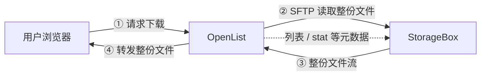
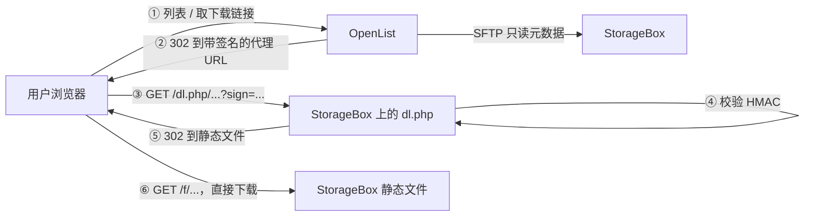
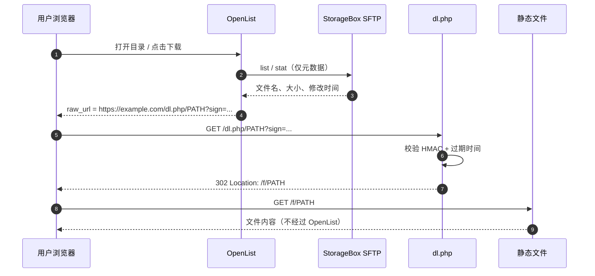

# OpenList StorageBox Proxy

让 OpenList 里**没有公网直链**的存储（SFTP、rsync 虚拟主机、StorageBox 等）也能 302 直链下载：文件不经过 OpenList 中转，浏览器直接向存储所在的主机取文件。

- 一个 `dl.php` 入口，整个 `public/` 丢进网站根目录即可
- 用 OpenList 同款 HMAC 校验链接，不裸奔
- 多挂载点、最长前缀匹配
- 302 到静态文件，支持 Range / 断点续传
- 路径穿越和符号链接逃逸防护
- 无 Composer 依赖，PHP 8.0+

---

## 它解决什么问题

很多 StorageBox / 虚拟主机只给 SFTP 或 rsync，没有公网直链。用 OpenList 的 SFTP 驱动挂载后，下载会变成这样：OpenList 先从 StorageBox 读完整文件，再转发给用户。两边各承担一份完整流量。



这个项目把路径拉直：OpenList 只负责目录和签名，真正下载时浏览器直接去 StorageBox。



下载时序：



> OpenList 的 `/d/<path>` 端点也走同一套逻辑：先 302 到“下载代理 URL”，再由 `dl.php` 302 到静态文件。两条路都不会让 OpenList 打开文件。

---

## 快速开始

### 1. 上传

把 `public/` **里面的内容**（不是 `public` 文件夹本身）上传到网站根目录：

```text
public_html/
├── dl.php
├── bootstrap.php
├── config.sample.php
├── config.php          # cp config.sample.php config.php 之后生成
├── .htaccess
├── scripts/
├── src/
└── tests/
```

所有文件都在同一层，没有额外的应用子目录。

> 建议放在独立子域或独立目录。如果直接丢进已有站点的根目录，`src/`、`tests/`、`scripts/` 可能和现有目录重名；改名后同步改 `dl.php` 和 `.htaccess` 即可。

也可以直接下载 Release 里的 `openlist-proxy.zip`（没有 zip 时会生成 `openlist-proxy.tar.gz`），解压到 `public_html`。

### 2. 建静态入口

假设你的文件在 `/home/username/files`：

```bash
cd /home/username/public_html
ln -s /home/username/files f
```

`f` 这个名字可以换，只要和后面 `config.php` 里的 `public` 对上。

> 有些面板的 `~/public_html` 本身是符号链接。传文件和建软链时优先用真实路径，例如 `~/domains/example.com/public_html/`。

### 3. 配置

```bash
cd /home/username/public_html
cp config.sample.php config.php
nano config.php
```

最少改这三处：

```php
'token' => '你的 OpenList 管理员 Token',

'mounts' => [
    '/storagebox' => [
        'root'   => '/home/username/files',
        'public' => '/f',
    ],
],
```

- `token`：OpenList 后台 **设置 → 其他 → Token**。
- `mounts` 的键：OpenList 里的挂载路径，例如 `/storagebox`。
- `root`：这个挂载在服务器上的真实目录，必须和 OpenList SFTP 的“根文件夹路径”一致。
- `public`：静态入口的 URL。`/f` 表示同域名下的 `/f`；也可以写完整地址，例如 `https://cdn.example.com/f`。
- `path_prefix`：通常留空，自动从 `dl.php` 的 URL 推断。只有用了 `/dl/...` 这类 rewrite 才需要手动填。

### 4. 配置 OpenList

编辑这个 SFTP 存储：

| 项目 | 值 |
| --- | --- |
| 挂载路径 | `/storagebox` |
| 根文件夹路径 | `/home/username/files` |
| 下载代理 URL | `https://example.com/dl.php` |
| WebDAV 策略 | `使用代理网址`（如果要用 WebDAV） |

注意：

- **下载代理 URL 结尾不要带 `/`**。OpenList 是直接拼接路径的。
- SFTP 驱动本身是 `OnlyProxy`，所以 **Web 代理开关不开都可以**。
- 如果你在用 WebDAV，把策略设为 `use_proxy_url`，否则 WebDAV 下载可能仍然走 OpenList。
- `链接过期时间`（`link_expiration`，单位小时）为 `0` 时签名永不过期；非 0 时 `dl.php` 会校验过期时间。

### 5. 验证

先放一个测试文件：

```bash
echo 'hello' > /home/username/files/hello.txt
curl -I https://example.com/f/hello.txt
# 期望 200
```

再在 OpenList 里点一次下载，浏览器网络面板应该看到：

1. `GET /dl.php/storagebox/...?sign=...` → `302`
2. `GET /f/...` → `200`

也可以命令行生成测试链接：

```bash
php scripts/sign.php /storagebox/hello.txt https://example.com/dl.php
```

单元测试：

```bash
php tests/run.php
# OK (35 assertions)
```

---

## 配置项

| 键 | 说明 |
| --- | --- |
| `token` | OpenList 管理员 Token，用于校验签名。 |
| `path_prefix` | `dl.php` 的 URL 前缀。留空自动推断；用 rewrite 时再填。 |
| `mounts` | OpenList 挂载路径 → `root`（本地绝对路径）+ `public`（静态 URL 前缀）。 |
| `require_sign` | 是否校验签名。强烈建议 `true`。 |
| `stream_fallback` | 没配 `public` 时是否退化成 PHP 直接输出文件。仍然不经过 OpenList，但会占用 PHP 连接。 |
| `debug` | 把请求路径写进 PHP error_log，排查完关掉。 |

多个挂载就继续往 `mounts` 里加，匹配时取最长前缀，所以 `/` 和 `/storagebox` 可以共存。

---

## 原理

OpenList 的 SFTP 驱动是 `OnlyProxy`，本身不产生公网直链。给存储填上 **下载代理 URL** 后，OpenList 需要代理时会生成：

```text
https://example.com/dl.php/<OpenList 路径>?sign=<签名>
```

并直接 302 过去，不会先打开文件。`dl.php` 验证签名后，把 OpenList 路径去掉挂载前缀，映射到本地文件，再 302 到：

```text
https://example.com/f/<相对路径>
```

浏览器最后直接向 Apache/Nginx 请求静态文件。

### 签名算法

OpenList 用管理员 Token 对路径签名，PHP 里必须完全一致：

```php
$expire = 0; // 0 = 永不过期；否则是 Unix 时间戳
$data   = $path . ':' . $expire;
$sign   = strtr(
    base64_encode(hash_hmac('sha256', $data, $token, true)),
    '+/',
    '-_'
) . ':' . $expire;
```

几个容易踩的点：

- `path` 是 **URL 解码后** 的 OpenList 完整路径，包含挂载路径，例如 `/storagebox/电影/foo.mkv`。
- 用 URL-safe Base64，但 **保留 `=` 填充**。
- `expire` 为 `0` 表示永不过期。
- Token 在 OpenList 后台 **设置 → 其他 → Token**，不是用户密码。

---

## 安全与限制

- **Token 是密钥**。`config.php` 不要提交到 Git。项目里的 `.gitignore` 已经忽略它。
- **最终静态 URL 不过期，也可以被转发**。签名只保护“从 OpenList 跳到静态文件”这一步；一旦浏览器拿到 `/f/...`，这个地址在文件被移动/删除前一直有效。这是 302 直链的固有特性。
  - 如果需要“链接过期后彻底失效”，把 `public` 留空并打开 `stream_fallback`，让 PHP 每次校验签名后自己输出文件。
  - 也可以用一段随机字符串作为静态目录名（例如 `f-7d3a...`），降低被枚举的概率。
- **路径穿越和符号链接逃逸**已经拦截：`..`、空段、`realpath` 越出 `root` 都会返回 404。
- **目录列表**：包里的 `.htaccess` 默认已经加了 `Options -Indexes`；如果和现有站点冲突，可以删掉那一行，并在数据目录单独加一个 `.htaccess`。
- **敏感文件默认拒绝直接访问**：站点根目录的 `.htaccess` 会拒绝 `config.php`、`bootstrap.php`，以及 `src/`、`tests/`、`scripts/` 下的所有文件。
  - Nginx 用户请在站点配置里加：
    ```nginx
    location ~ ^/(src|tests|scripts)/ { deny all; }
    location = /config.php { deny all; }
    location = /bootstrap.php { deny all; }
    ```
    如果项目放在子目录，记得把路径前缀补上。
- **PHP 的 `open_basedir`** 必须允许读取 `root`。大多数虚拟主机默认允许整个用户目录。
- **Apache 必须允许跟随符号链接**（`Options +FollowSymLinks` 或 `SymLinksIfOwnerMatch`）。如果主机禁止，可以用 DirectAdmin 的 Custom HTTPD Config 配 `Alias /f /home/username/files`。
- **HTTPS**：代理 URL 和静态 URL 都建议走 HTTPS。
- **Token 轮换**：改了 OpenList Token 后，同步改根目录的 `config.php`。

---

## 常见问题

| 现象 | 可能原因 | 处理 |
| --- | --- | --- |
| `/f/...` 返回 403 | Apache 不允许跟随符号链接 | 检查 `Options`；或用 `Alias /f /home/username/files` |
| `/f/...` 返回 404 | 软链路径不对，或文件不在 `root` 下 | `ls -l public_html/f`、`realpath public_html/f/hello.txt` |
| SFTP 往 `public_html` 传文件失败 | `~/public_html` 可能是符号链接，部分客户端不跟随 | 直接传到真实路径，如 `~/domains/example.com/public_html/` |
| `dl.php` 返回 404 `mount not found` | `mounts` 的键和 OpenList 挂载路径不一致 | 打开 `debug`，看 error_log 里的实际 path |
| `dl.php` 返回 404 `not found` | `root` 配错，或 OpenList 路径层级不对 | 确认 SFTP 的“根文件夹路径”和 `root` 是同一个目录 |
| 401 `bad sign` | Token 不一致；或 URL 被代理/CDN 规范化了 | 核对 Token；检查中间层是否改写 `//`、`..`、`%2F` |
| 401 `expired` | OpenList 的链接过期时间到了 | 重新点下载，或把 `link_expiration` 设为 0 |
| 500 `token not configured` | 还在用 `CHANGE_ME` | 填真实 Token |
| 500 `public base not configured` | `public` 为空且没开 `stream_fallback` | 配 `public`，或打开 `stream_fallback` |
| 下载走回 OpenList | OpenList 没用到“下载代理 URL” | 确认字段没写错、结尾没斜杠；SFTP 正常不需要开 Web 代理 |
| OpenList 里复制大目录很慢 | SFTP 没有原生 Copy，OpenList 会回退成“读源文件再写到目标” | 单文件正常；大目录建议在服务器上用 `cp`/`rsync` |
| PATH_INFO 被主机禁用 | 访问 `/dl.php/...` 直接 404，PHP 没执行 | 加 rewrite，见下 |

如果 PATH_INFO 被禁用，加一条 rewrite：

```apache
RewriteEngine On
RewriteRule ^dl/(.*)$ dl.php [L,QSA]
```

然后把 OpenList 的 **下载代理 URL** 改成 `https://example.com/dl`，并在 `config.php` 里设置：

```php
'path_prefix' => '/dl',
```

---

## 开发与测试

```bash
make test      # 单元测试
make lint      # PHP 语法检查
make package   # 生成 dist/openlist-proxy.zip（没有 zip 时生成 .tar.gz）
```

本地没有 PHP 时可以用 Docker：

```bash
docker run --rm -v "$PWD":/src -w /src/public \
  php:8.2-cli php tests/run.php

docker run --rm -v "$PWD":/src php:8.2-cli \
  sh -c 'find /src/public /src/scripts -name "*.php" -print0 | xargs -0 -n1 php -l'
```

目录结构：

```text
public/                       # 部署包：把这层里面的东西丢进 public_html
├── dl.php                    # 唯一 Web 入口
├── bootstrap.php
├── config.sample.php
├── .htaccess                 # 拒绝 config/bootstrap 和 src/tests/scripts
├── scripts/sign.php
├── src/
└── tests/run.php
scripts/package.sh
Makefile
LICENSE
```

---

## English quick start

A tiny PHP 302 proxy for OpenList storages that have no public direct link (SFTP, rsync-only StorageBoxes, etc.).

1. Upload the **contents** of `public/` to `public_html`.
2. Symlink your data directory: `ln -s /home/username/files f`.
3. `cp config.sample.php config.php` and fill in `token` plus the `mounts` mapping.
4. In OpenList, set **Download Proxy URL** to `https://example.com/dl.php` (no trailing slash).
5. Test: `curl -I https://example.com/f/hello.txt` and click a download in OpenList.

OpenList signs `HMAC-SHA256(path + ":" + expire, token)` with URL-safe Base64 (padding kept). `dl.php` verifies it, maps the OpenList path to a local file, and redirects to the static URL.

---

## License

MIT. See [LICENSE](LICENSE).
