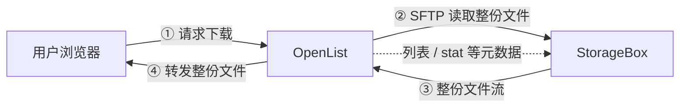
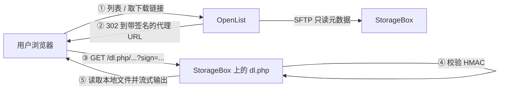
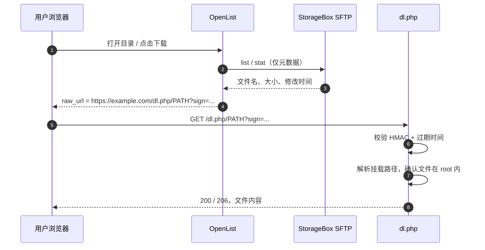

# OpenList StorageBox Proxy

[](https://vibecoded.fyi/)

让 OpenList 里**没有公网直链**的存储（SFTP、rsync 虚拟主机、StorageBox 等）也能下载：OpenList 只负责目录和签名，真正的文件由本机的 `dl.php` **校验签名后流式输出**。

- 一个 `dl.php` 入口，发布包解压后直接复制到网站根目录即可
- 每次下载都校验 OpenList 同款 HMAC，不再暴露永久静态直链
- 多挂载点、最长前缀匹配
- 支持 Range / HEAD / 断点续传 / 媒体拖动
- 只对文本型 MIME 启用 gzip，二进制和 Range 响应永不压缩
- 路径穿越和符号链接逃逸防护
- 无 Composer 依赖，PHP 8.0+

---

## 它解决什么问题

很多 StorageBox / 虚拟主机只给 SFTP 或 rsync，没有公网直链。用 OpenList 的 SFTP 驱动挂载后，下载会变成这样：OpenList 先从 StorageBox 读完整文件，再转发给用户。两边各承担一份完整流量。



这个项目把路径拉直：OpenList 只负责目录和签名，文件由存储所在主机上的 `dl.php` 读取并输出，不再经过 OpenList 中转。



下载时序：



> 关键变化：`dl.php` 不再 302 到 `/f/...` 静态目录。没有有效签名就拿不到文件，断点续传的每个 Range 请求也都会重新验签。

---

## 快速开始

### 1. 上传

下载 Release 里的 `openlist-proxy.zip`（没有 zip 时会生成 `openlist-proxy.tar.gz`），解压后直接把里面的文件复制到网站根目录。使用 Git 仓库时，仓库根目录本身就是部署目录，不再额外经过 `public/` 这一层。

```text
public_html/
├── dl.php
├── bootstrap.php
├── config.sample.php
├── config.php          # cp config.sample.php config.php 之后生成
├── .htaccess
├── scripts/
├── src/
└── tests/
```

覆盖升级时保留已有的 `config.php`，发布包不会携带或覆盖它。

> 建议放在独立子域或独立目录。如果直接丢进已有站点的根目录，`src/`、`tests/`、`scripts/` 可能和现有目录重名；改名后同步改 `bootstrap.php` 和 `.htaccess` 即可。

### 2. 配置

```bash
cd /home/username/public_html
cp config.sample.php config.php
nano config.php
```

最少改这两处：

```php
'token' => '你的 OpenList 管理员 Token',

'mounts' => [
    '/storagebox' => [
        'root' => '/home/username/files',
    ],
],
```

- `token`：OpenList 后台 **设置 → 其他 → Token**。
- `mounts` 的键：OpenList 里的挂载路径，例如 `/storagebox`。
- `root`：这个挂载在服务器上的真实目录，必须和 OpenList SFTP 的“根文件夹路径”一致。
- `path_prefix`：通常留空，自动从 `dl.php` 的 URL 推断。只有用了 `/dl/...` 这类 rewrite 才需要手动填。
- `base_url`：可选，只给 `scripts/sign.php` 生成测试链接时使用，例如 `https://example.com`。

**不需要再创建 `/f` 软链，也不要把数据目录映射成公开静态目录。**

### 3. 配置 OpenList

编辑这个 SFTP 存储：

| 项目 | 值 |
| --- | --- |
| 挂载路径 | `/storagebox` |
| 根文件夹路径 | `/home/username/files` |
| 下载代理 URL | `https://example.com/dl.php` |
| WebDAV 策略 | `使用代理网址`（如果要用 WebDAV） |

注意：

- **下载代理 URL 结尾不要带 `/`**。OpenList 是直接拼接路径的。
- SFTP 驱动本身是 `OnlyProxy`，所以 **Web 代理开关不开都可以**。
- 如果你在用 WebDAV，把策略设为 `use_proxy_url`，否则 WebDAV 下载可能仍然走 OpenList。
- **链接过期时间**（`link_expiration`，单位小时）建议设成非 `0`。设为 `0` 时签名永不过期；非 `0` 时 `dl.php` 会校验过期时间。

### 4. 验证

先放一个测试文件：

```bash
echo 'hello' > /home/username/files/hello.txt
```

没有签名时必须被拒绝：

```bash
curl -I https://example.com/dl.php/storagebox/hello.txt
# 期望 401 missing sign
```

生成带签名的测试链接：

```bash
php scripts/sign.php /storagebox/hello.txt
```

如果 `config.php` 里配置了 `base_url`，会直接输出完整 URL；否则在前面补上站点地址：

```bash
curl -I 'https://example.com/dl.php/storagebox/hello.txt?sign=...'
# 期望 200
```

再在 OpenList 里点一次下载，浏览器网络面板应该只看到一个请求：

```text
GET /dl.php/storagebox/...?sign=...   → 200 / 206
```

断点续传：

```bash
curl -I -H 'Range: bytes=0-4' \
  'https://example.com/dl.php/storagebox/hello.txt?sign=...'
# 期望 206，Content-Range: bytes 0-4/5
```

单元测试：

```bash
php tests/run.php
# OK (56 assertions)
```

---

## 配置项

| 键 | 说明 |
| --- | --- |
| `token` | OpenList 管理员 Token，用于校验签名。 |
| `path_prefix` | `dl.php` 的 URL 前缀。留空自动推断；用 rewrite 时再填。 |
| `base_url` | 可选，`scripts/sign.php` 生成完整测试 URL 时使用的站点地址。 |
| `mounts` | OpenList 挂载路径 → `root`（本地绝对路径）。 |
| `debug` | 把请求路径写进 PHP error_log，排查完关掉。 |

多个挂载就继续往 `mounts` 里加，匹配时取最长前缀，所以 `/` 和 `/storagebox` 可以共存。

旧版本配置里的 `public`、`require_sign`、`stream_fallback` 已废弃，会被忽略。**签名校验现在始终开启，不能通过配置关闭。**

---

## 原理

OpenList 的 SFTP 驱动是 `OnlyProxy`，本身不产生公网直链。给存储填上 **下载代理 URL** 后，OpenList 需要代理时会生成：

```text
https://example.com/dl.php/<OpenList 路径>?sign=<签名>
```

并直接 302 过去，不会先打开文件。`dl.php` 验证签名后，把 OpenList 路径去掉挂载前缀，映射到本地文件，然后自己读取并输出：

```text
GET /dl.php/storagebox/电影/foo.mkv?sign=...
→ 200 Content-Type: video/x-matroska
→ 文件内容（支持 Range）
```

### 签名算法

OpenList 用管理员 Token 对路径签名，PHP 里必须完全一致：

```php
$expire = 0; // 0 = 永不过期；否则是 Unix 时间戳
$data   = $path . ':' . $expire;
$sign   = strtr(
    base64_encode(hash_hmac('sha256', $data, $token, true)),
    '+/',
    '-_'
) . ':' . $expire;
```

几个容易踩的点：

- `path` 是 **URL 解码后** 的 OpenList 完整路径，包含挂载路径，例如 `/storagebox/电影/foo.mkv`。
- 用 URL-safe Base64，但 **保留 `=` 填充**。
- `expire` 为 `0` 表示永不过期。
- Token 在 OpenList 后台 **设置 → 其他 → Token**，不是用户密码。

---

## 安全与限制

- **Token 是密钥**。`config.php` 不要提交到 Git。项目里的 `.gitignore` 已经忽略它。
- **每个下载请求都必须带有效签名**。没有签名、签名错误或链接过期都会返回 `401`，不再有可以绕过的静态 `/f/...` 地址。
- **签名链接在过期前仍然可以被复制和转发**。这是无状态 HMAC 的固有特性；要真正做到一次性链接，需要额外的 nonce/数据库存储，本项目暂不包含。建议在 OpenList 里设置非 `0` 的链接过期时间。
- **数据目录不要放在 Web 可直接访问的位置**。如果必须放在 `public_html` 下，请用 `.htaccess` 或 Nginx 规则拒绝直接访问。
- **路径穿越和符号链接逃逸**已经拦截：`..`、空段、`realpath` 越出 `root` 都会返回 404。
- **目录列表**：包里的 `.htaccess` 默认已经加了 `Options -Indexes`；如果和现有站点冲突，可以删掉那一行，并在数据目录单独加一个 `.htaccess`。
- **敏感文件默认拒绝直接访问**：站点根目录的 `.htaccess` 会拒绝 `config.php`、`bootstrap.php`，以及 `src/`、`tests/`、`scripts/` 下的所有文件。
  - Nginx 用户请在站点配置里加：
    ```nginx
    location ~ ^/(src|tests|scripts)/ { deny all; }
    location = /config.php { deny all; }
    location = /bootstrap.php { deny all; }
    ```
    如果项目放在子目录，记得把路径前缀补上。
- **PHP 的 `open_basedir`** 必须允许读取 `root`。大多数虚拟主机默认允许整个用户目录。
- **HTTPS**：代理 URL 建议走 HTTPS，避免签名链接在传输中泄漏。
- **Token 轮换**：改了 OpenList Token 后，同步改根目录的 `config.php`。

### gzip 压缩策略

压缩使用 **MIME 白名单**，只有文本型内容允许 gzip：

```text
text/*
application/json
application/ld+json
application/xml
application/xhtml+xml
application/javascript
application/x-javascript
image/svg+xml
application/x-subrip
application/vnd.apple.mpegurl
application/dash+xml
```

视频、音频、图片（SVG 除外）、压缩包、PDF、字体、`application/octet-stream` 等二进制类型一律不压缩。

压缩由 `dl.php` 自己完成，而不是交给 Apache/Nginx：

- 文本文件且客户端接受 gzip 时才压缩
- 小于 2 MiB 的文本文件在 PHP 内压缩，能返回压缩后的 `Content-Length`
- 更大的文本文件流式 gzip，不返回 `Content-Length`
- 二进制文件永远不压缩，始终返回原始 `Content-Length`
- `Range` / `206` 永远不压缩，保证断点续传和播放器 seek
- `.htaccess` 对 `dl.php` 显式设置 `no-gzip`，避免 Apache 再压缩一次导致长度丢失
- `.htaccess` 对 `dl.php` 设置 `ap_trust_cgilike_cl 1`。Apache 2.4.62+ 配合 PHP-FPM 时会丢弃脚本设置的 `Content-Length` 并强制 chunked，这个开关让 Apache 信任脚本给出的长度
- `Cache-Control` 带 `no-transform`，避免 Cloudflare 等 CDN 改动响应

`.htaccess` 里的 `AddOutputFilterByType DEFLATE ...` 白名单仍然保留，用于站点里的静态文本文件；`RemoveOutputFilter DEFLATE` 会先清掉主机可能配置的全量压缩。

Nginx 不读取 `.htaccess`，建议同样使用白名单：

```nginx
gzip on;
gzip_vary on;
gzip_types
    text/plain text/css text/xml text/csv text/vtt
    application/json application/ld+json application/xml
    application/xhtml+xml application/javascript
    image/svg+xml application/x-subrip
    application/vnd.apple.mpegurl application/dash+xml;
```

不要使用 `gzip_types *`，否则二进制文件也会被压缩。`dl.php` 返回 `Content-Encoding: gzip` 时 Nginx 不会再次压缩；二进制响应则保持原始长度。

小于 1 KiB 的文本文件不会压缩，属于正常现象；以响应头是否出现 `Content-Encoding: gzip` 为准。

如果站点前面有 Cloudflare，响应里还会带 `Cache-Control: no-transform`。Cloudflare 在压缩或重新压缩响应时可能移除 `Content-Length`，加上 `no-transform` 后才会保留源站的文件大小，浏览器下载时也才能显示总大小。

### 大文件与性能

每个下载都会占用一个 PHP worker。代码里已经做了：

- 清理输出缓冲，避免整份文件进内存
- `set_time_limit(0)`，避免 PHP 超时截断
- 64 KiB 分块输出，客户端断开后停止读取
- `Cache-Control: private, no-store, no-transform`，避免共享缓存保存签名内容，也避免 Cloudflare 等 CDN 改动响应并丢失 `Content-Length`
- 音视频、HLS/DASH 清单和 WebVTT 使用 `Content-Disposition: inline`，其他文件使用 `attachment`

如果主机有 Nginx，可以在未来加 `X-Accel-Redirect`；Apache 有 `mod_xsendfile` 时也可以用 `X-Sendfile`，让鉴权后由 Web 服务器发送文件。当前版本默认使用 PHP 流式输出，兼容性最好。

---

## 从旧版本升级

旧版本会在验签后 302 到 `/f/...` 静态软链，那个地址可以绕过 `dl.php`。升级时：

1. 更新 `dl.php`、`src/`、`.htaccess` 等文件。
2. **删除** `public_html/f` 这个软链，或删除对应的 `Alias`。
3. 从 `config.php` 里删掉 `public`、`require_sign`、`stream_fallback`（不删也会被忽略）。
4. 确认数据目录不能被 Web 直接访问。
5. 重新点一次 OpenList 下载验证：网络面板里应该只有 `dl.php` 请求，没有 `/f/...`。

---

## 常见问题

| 现象 | 可能原因 | 处理 |
| --- | --- | --- |
| `dl.php` 返回 401 `missing sign` | URL 没有带 `sign` | 从 OpenList 重新取链接；确认中间层没有丢掉 query string |
| 401 `bad sign` | Token 不一致；或 URL 被代理/CDN 规范化了 | 核对 Token；检查中间层是否改写 `//`、`..`、`%2F` |
| 401 `expired` | OpenList 的链接过期时间到了 | 重新点下载，或把 `link_expiration` 设为 0 |
| 500 `token not configured` | 还在用 `CHANGE_ME` | 填真实 Token |
| `dl.php` 返回 404 `mount not found` | `mounts` 的键和 OpenList 挂载路径不一致 | 打开 `debug`，看 error_log 里的实际 path |
| `dl.php` 返回 404 `not found` | `root` 配错，或 OpenList 路径层级不对 | 确认 SFTP 的“根文件夹路径”和 `root` 是同一个目录 |
| 下载到一半中断 | PHP/FPM/反向代理超时 | 检查 `max_execution_time`、FPM `request_terminate_timeout`、Nginx `fastcgi_read_timeout` |
| 浏览器下载不显示总大小 | Apache 2.4.62+ + PHP-FPM 丢弃了脚本的 `Content-Length`，或 CDN 压缩后移除了长度 | 保留 `.htaccess` 里的 `ap_trust_cgilike_cl 1`、`no-gzip` 和响应头 `Cache-Control: no-transform` |
| 视频不能拖动 | 客户端没把 `Range` 发给 `dl.php` | 确认播放器请求的是带 `sign` 的完整 URL，并可返回 206 |
| 下载走回 OpenList | OpenList 没用到“下载代理 URL” | 确认字段没写错、结尾没斜杠；SFTP 正常不需要开 Web 代理 |
| OpenList 里复制大目录很慢 | SFTP 没有原生 Copy，OpenList 会回退成“读源文件再写到目标” | 单文件正常；大目录建议在服务器上用 `cp`/`rsync` |
| PATH_INFO 被主机禁用 | 访问 `/dl.php/...` 直接 404，PHP 没执行 | 加 rewrite，见下 |

如果 PATH_INFO 被禁用，加一条 rewrite：

```apache
RewriteEngine On
RewriteRule ^dl/(.*)$ dl.php [L,QSA]
```

然后把 OpenList 的 **下载代理 URL** 改成 `https://example.com/dl`，并在 `config.php` 里设置：

```php
'path_prefix' => '/dl',
```

---

## 开发与测试

```bash
make test      # 单元测试
make lint      # PHP 语法检查
make package   # 生成 dist/openlist-proxy.zip（没有 zip 时生成 .tar.gz）
```

本地没有 PHP 时可以用 Docker：

```bash
docker run --rm -v "$PWD":/src -w /src \
  php:8.2-cli php tests/run.php

docker run --rm -v "$PWD":/src -w /src php:8.2-cli \
  sh -c 'for file in dl.php bootstrap.php config.sample.php; do php -l "$file"; done && find src scripts tests -name "*.php" -print0 | xargs -0 -n1 php -l'
```

目录结构：

```text
./                            # 仓库根目录，也是发布包的部署根目录
├── dl.php                    # 唯一 Web 入口，验签 + 流式输出
├── bootstrap.php
├── config.sample.php
├── .htaccess                 # 拒绝 config/bootstrap 和 src/tests/scripts
├── scripts/
│   ├── sign.php
│   └── package.sh
├── src/
├── tests/run.php
├── Makefile
└── LICENSE
```

---

## English quick start

A tiny PHP download proxy for OpenList storages that have no public direct link (SFTP, rsync-only StorageBoxes, etc.). Every request is signature-checked, then `dl.php` streams the file itself; there is no public static file directory.

1. Extract the release archive and copy its contents directly to `public_html`. The repository root uses the same deployable layout.
2. `cp config.sample.php config.php` and fill in `token` plus the `mounts` mapping (`root` only).
3. In OpenList, set **Download Proxy URL** to `https://example.com/dl.php` (no trailing slash). Set a non-zero `link_expiration` if you want links to expire.
4. Test: `php scripts/sign.php /storagebox/hello.txt`, then `curl -I` the returned signed URL. Without `sign`, `dl.php` returns `401`.

OpenList signs `HMAC-SHA256(path + ":" + expire, token)` with URL-safe Base64 (padding kept). `dl.php` verifies it, maps the OpenList path to a local file, and streams the file with Range support. No `/f` symlink is needed.

---

## License

MIT. See [LICENSE](LICENSE).
