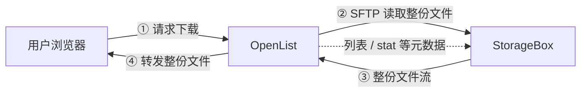
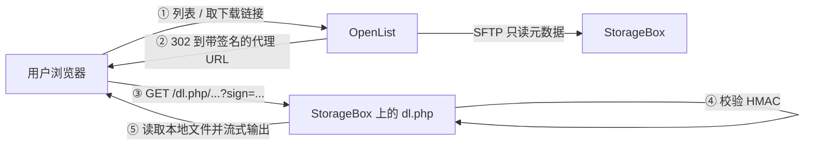
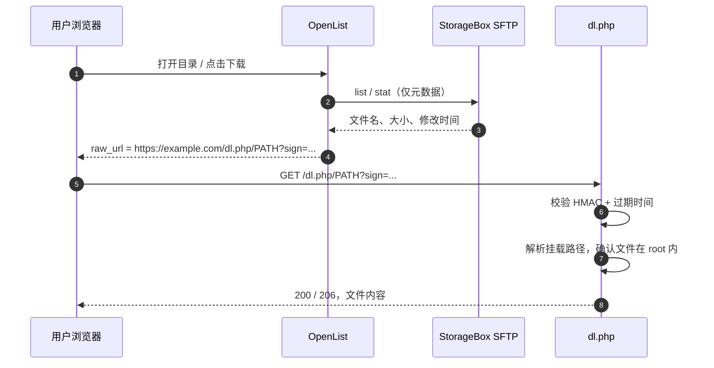

# 架构与设计决策

README 负责部署与日常操作；这里记录工作原理、签名算法和关键设计决策。

## 它解决什么问题

很多 StorageBox / 虚拟主机只给 SFTP 或 rsync，没有公网直链。用 OpenList 的 SFTP 驱动挂载后，下载会变成这样：OpenList 先从 StorageBox 读完整文件，再转发给用户。两边各承担一份完整流量。



这个项目把路径拉直：OpenList 只负责目录和签名，文件由存储所在主机上的 `dl.php` 读取并输出，不再经过 OpenList 中转。



下载时序：



> 关键变化：`dl.php` 不再 302 到 `/f/...` 静态目录。没有有效签名就拿不到文件，断点续传的每个 Range 请求也都会重新验签。

## 工作原理

OpenList 的 SFTP 驱动是 `OnlyProxy`，本身不产生公网直链。给存储填上 **下载代理 URL** 后，OpenList 需要代理时会生成：

```text
https://example.com/dl.php/<OpenList 路径>?sign=<签名>
```

并直接 302 过去，不会先打开文件。`dl.php` 验证签名后，把 OpenList 路径去掉挂载前缀，映射到本地文件，然后自己读取并输出：

```text
GET /dl.php/storagebox/电影/foo.mkv?sign=...
→ 200 Content-Type: video/x-matroska
→ 文件内容（支持 Range）
```

启用 `xsendfile` 时，验签后改为交给 Apache 原生分发，见 [performance.md](performance.md)。

## 签名算法

OpenList 用管理员 Token 对路径签名，PHP 里必须完全一致：

```php
$expire = 0; // 0 = 永不过期；否则是 Unix 时间戳
$data   = $path . ':' . $expire;
$sign   = strtr(
    base64_encode(hash_hmac('sha256', $data, $token, true)),
    '+/',
    '-_'
) . ':' . $expire;
```

几个容易踩的点：

- `path` 是 **URL 解码后** 的 OpenList 完整路径，包含挂载路径，例如 `/storagebox/电影/foo.mkv`。
- 用 URL-safe Base64，但 **保留 `=` 填充**。
- `expire` 为 `0` 表示永不过期。
- Token 在 OpenList 后台 **设置 → 其他 → Token**，不是用户密码。

## 关键设计决策

- **始终验签，无静态旁路**。旧版验签后 302 到 `/f/...` 静态软链，该地址可绕过 `dl.php` 直接下载，已移除；`require_sign` 等开关一并删除。每个 Range 请求都重新验签。
- **无状态 HMAC 签名链接**。不依赖 session/数据库，部署简单；代价是链接在过期前可以被复制转发。一次性链接需要 nonce/存储，不在本项目范围。建议 OpenList 设置非 `0` 的 `link_expiration`。
- **路径安全**。拒绝 `..`、空段、NUL；`realpath` 收敛后校验是否仍在挂载 `root` 内，符号链接逃逸一律 404。
- **传输策略**。默认 PHP 流式输出，兼容性最好（mod_php / PHP-FPM / 共享主机）；可选 X-Sendfile 把验签后的文件分发交给 Apache 原生 sendfile，文本 gzip 仍走 PHP，见 [performance.md](performance.md)。
- **压缩策略**。只对文本型 MIME 白名单启用 gzip；二进制和 Range 响应永不压缩，保证断点续传与播放器 seek，见 [performance.md](performance.md)。